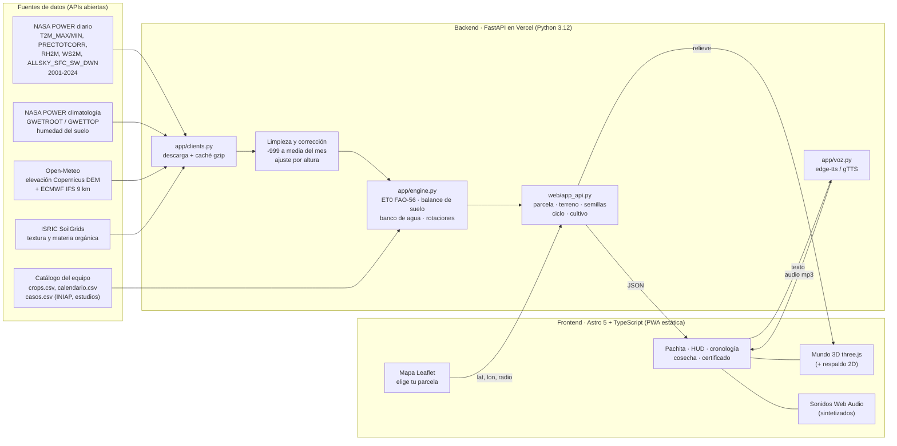
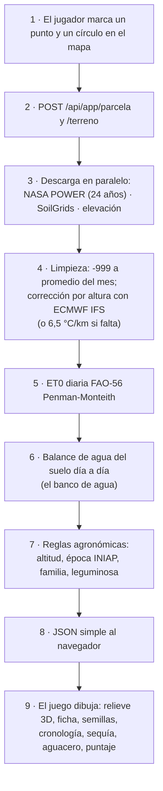

# 1 · Arquitectura, datos y stack

## 1.1 Vista general

## 1.2 De la API al juego, paso a paso

## 1.3 Extracción de datos de la API

| Dato | Servicio | Cómo se pide | Para qué |
|---|---|---|---|
| Clima diario 2001–2024 | **NASA POWER** `temporal/daily/point`, comunidad `AG` | `parameters=T2M_MAX,T2M_MIN,PRECTOTCORR,RH2M,WS2M,ALLSKY_SFC_SW_DWN` | Lluvia, evaporación, calor, año seco |
| Humedad de suelo en raíces | **NASA POWER** `temporal/climatology/point` | `GWETROOT,GWETTOP` (0–1, mes a mes) | Ficha "Así es tu tierra" |
| Altura y relieve | **Open-Meteo** (Copernicus DEM) | hasta 100 puntos por consulta | Malla 3D de la parcela, pendiente |
| Corrección de lluvia y temperatura | **ECMWF IFS 9 km** vía Open-Meteo | serie diaria del punto | Desfase de la celda NASA (≈ 55 × 70 km) |
| Textura del suelo | **ISRIC SoilGrids** | arcilla, arena, limo, materia orgánica | Agua útil del suelo (mm por metro de raíz) |

**Caché y velocidad:** cada respuesta válida se guarda en `cache/*.json.gz` (nunca una respuesta fallida). Cuatro sitios de demostración van en `app/semillas/` para que el juego funcione sin red. En producción, un punto nuevo tarda ≈ 12 s la primera vez (NASA POWER) y la pantalla de carga cubre la espera.

## 1.3b ¿De qué satélite salen los datos?

**No hay un solo satélite.** NASA POWER entrega variables que vienen de un *reanálisis* (un modelo que asimila observaciones de muchos satélites, estaciones y globos) y de instrumentos satelitales específicos.

| Dato del juego | Producto | Origen real | Satélites |
|---|---|---|---|
| Temperatura máx./mín. a 2 m, humedad relativa, viento | **MERRA-2** (NASA GMAO) | Reanálisis: modelo + observaciones asimiladas, malla de ≈ 50 × 60 km, desde 1980 | Muchos (no es una medición directa de un solo sensor) |
| Lluvia corregida (`PRECTOTCORR`) | **MERRA-2** | Lluvia del modelo corregida con observaciones | Modelo; en la sierra centro duplica la lluvia (San Juan: 658 mm medidos frente a 1.415) |
| Radiación solar (`ALLSKY_SFC_SW_DWN`) | **CERES** | Medición de radiación | Instrumentos CERES en **Terra, Aqua y Suomi NPP** |
| Humedad del suelo en raíces (`GWETROOT`, `GWETTOP`) | **MERRA-2 / modelo GEOS** | Calculada por el modelo | No es medición satelital. SMAP sí mide humedad del suelo, pero el juego **todavía no lo usa** |
| Relieve y pendiente | **Copernicus DEM** (ESA) vía Open-Meteo | Modelo digital de elevación de radar satelital | **No es NASA** |
| Corrección de lluvia y temperatura | **ECMWF IFS 9 km** vía Open-Meteo | Modelo de pronóstico | **No es NASA** |
| Textura del suelo | **SoilGrids** (ISRIC) | Aprendizaje automático con datos de suelo y satélite | **No es NASA** |

**Lluvia satelital directa:** es **IMERG** (misión GPM, NASA). La investigación demostró que sigue mejor los meses que MERRA-2 (r 0,68 frente a 0,51; mejor en 50 de 85 estaciones del INAMHI) y está en la hoja de ruta, pero el juego aún no la usa. Ver [06-Investigacion.md](06-Investigacion.md).

**Cómo decirlo en el pitch:** "Usamos datos de NASA POWER: un reanálisis (MERRA-2) que integra observaciones de muchos satélites, más la radiación solar medida por los instrumentos CERES. La lluvia satelital directa (IMERG) es nuestro siguiente paso."

## 1.4 Limpieza y transformación de datos

| Paso | Qué se hace | Por qué |
|---|---|---|
| Faltantes | `-999` (valor "sin dato" de POWER) → promedio del mismo mes | Evitar lluvias o temperaturas absurdas |
| Escala espacial | La celda de POWER (0,5° × 0,625°) mezcla valles y páramos; se corrige mes a mes con ECMWF IFS 9 km (razón en lluvia, diferencia en temperatura). Respaldo: 6,5 °C por km de desnivel | En los Andes la celda llega a duplicar la lluvia |
| Unidades | mm, °C, MJ/m²/día → litros por parcela (÷ eficiencia 0,75), baldes, tanques, tanqueros | Quien más lo necesita no lee unidades técnicas |
| ET0 | FAO-56 Penman-Monteith con T, RH, viento y radiación | Estándar mundial de evaporación |
| Lluvia efectiva | 85 % de la lluvia diaria llega a la raíz | Escorrentía y pérdidas |
| Escenario seco | 20 % menos lluvia | "¿Y si el año es malo?" |
| Contadores del juego | calor ≥ 25 °C, aguacero ≥ 10 mm por día | Eventos visibles: ¡Arrarray! (calor, sequía) y ¡Achachay! (frío, aguacero) |

## 1.5 Stack

| Capa | Tecnología | Nota |
|---|---|---|
| Frontend | **Astro 5**, TypeScript, **three.js 0.170**, **Leaflet** | Sitio estático, instalable (PWA); `?sin3d=1` para equipos modestos |
| Animación y sonido | CSS/SVG por capas, Web Animations, **Web Audio** | Sin archivos de audio; modo económico en equipos lentos |
| Idioma | Español / English | La voz de Pachita cambia con el idioma |
| Backend | **FastAPI** (Python 3.12), NumPy | Función serverless; no guarda datos del jugador |
| Motor | `app/engine.py` (FAO-56, balance de suelo, rotaciones) | Un solo motor para el juego y el bot de Telegram |
| Voz | `edge-tts` (es-EC / `en-US-AnaNeural`), respaldo `gTTS` | Voz de niña, texto corto |
| Despliegue | **Vercel** con CI (pruebas, secretos, preview por PR) | `develop` publica en pacha-chat.vercel.app |
| Calidad | pytest (20 pruebas), Playwright para recorridos | El servidor decide los números; el navegador solo dibuja |

## 1.6 Qué manda el servidor y qué dibuja el juego

| Endpoint | Entrega | Lo que se ve |
|---|---|---|
| `POST /api/app/terreno` | Altura de una malla de puntos | Relieve 3D, pendiente |
| `POST /api/app/parcela` | Ficha NASA del punto (lluvia, ET0, temperatura, sol, humedad, década) | Tarjeta "Así es tu tierra" |
| `POST /api/app/semillas` | Los 13 cultivos: ¿se pueden sembrar aquí y ahora?, época, razón | Cartas de semillas con candado |
| `POST /api/app/ciclo` | Un ciclo día a día con clima real, riegos del jugador, humedad, estrés y puntaje | Cronología, sequía, tanque, estrellas |
| `POST /api/app/cultivo` | Veredicto de agua por mes y 3 rotaciones calculadas | Calendario de agua y rotación |
| `GET/POST /api/voz` | mp3 de Pachita (`lang` es/en); el GET es cacheable para frases fijas precargadas al sembrar | Voz del globo y avisos |

Regla de diseño: **todo número sale del servidor**; el juego no inventa datos.
