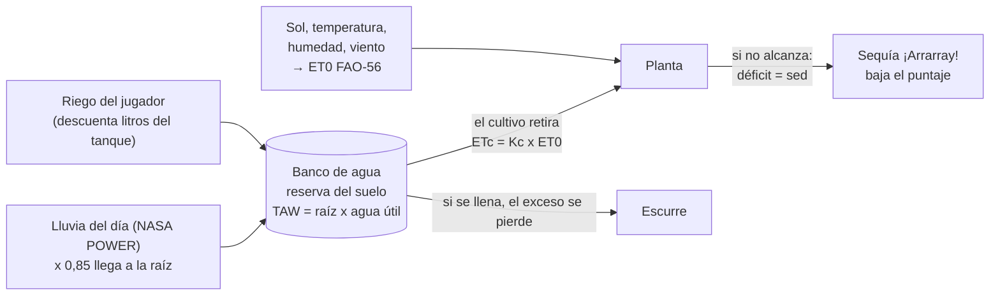

# 4 · El banco de agua y la rotación

## 4.1 La idea en una imagen
El suelo es una **alcancía de agua**. La lluvia **deposita**, el cultivo **retira** (cada día según el sol, el calor y la etapa de la planta) y, si la alcancía se vacía, a la planta le da sed. El **tanque** del juego es el agua extra que la familia puede **depositar regando**.

## 4.2 Las reglas (código: `banco_de_agua()` y `_balance_suelo()` en `app/engine.py`)

| Elemento | Cómo se calcula | Valor |
|---|---|---|
| **Capacidad del banco (TAW)** | profundidad de raíz del cultivo × agua útil del suelo | ej. papa 0,5 m × 150 mm/m = **75 mm** |
| Agua útil por textura | arenoso 70 · franco arenoso 110 · franco 150 · franco arcilloso 160 · arcilloso 140 mm/m | de SoilGrids; 110 si no hay dato |
| **Saldo inicial** | el día de siembra el suelo está a la mitad | 50 % de TAW |
| **Depósito** | lluvia diaria × 0,85 (lluvia efectiva) + riego | |
| **Retiro (demanda)** | ETc = Kc del día × ET0 del día | Kc por etapa: inicial → desarrollo → media → final |
| **Déficit (sed)** | ETc − agua realmente disponible (saldo + depósito) | |
| **Día con sed** | déficit ≥ 15 % de lo que pide (y ≥ 0,5 mm) | se ve como planta café y doblada |
| **Mes con problema** | déficit mensual ≥ 15 % de la demanda (y ≥ 5 mm) | |
| **Año bueno / malo** | déficit del ciclo < 10 % / ≥ 30 % de la demanda | |
| **Escenario seco** | misma simulación con 20 % menos lluvia | "¿y si el año es malo?" |
| **Eficiencia de riego** | 0,75: de cada 4 litros que salen, 3 llegan a la raíz | litros = mm × m² ÷ 0,75 |

### De los mm a lo que entiende una familia
1 mm de agua sobre 1 m² = 1 litro. Se muestra en **baldes de 20 L, tanques de 200 L y tanqueros de 10.000 L**, nunca en mm solos.

## 4.3 Dos usos del mismo banco

**A) Antes de sembrar (veredicto y calendario de agua).** El motor simula el ciclo completo **en cada uno de ~23 años** (2001–2024), sembrando el día 1 del mes elegido:
- **✅ Lluvia alcanza**: en ≥ 70 % de los años el déficit fue menor al 10 %.
- **⚠️ Regar a veces**: no cumple lo anterior, pero los años malos son ≤ 30 %.
- **❌ Necesita riego**: más del 30 % de los años son malos.
- **Semáforo por mes** del ciclo: verde si falla en ≤ 20 % de los años, amarillo hasta 50 %, rojo más de 50 %.
- **Mes crítico** y **riego por semana crítica**, para saber cuándo mirar el cielo.

**B) Jugando (ciclo día a día).** `POST /api/app/ciclo` toma **un año real** de NASA POWER y recorre el cultivo día por día con los riegos del jugador:
- El **tanque** de partida = el agua que haría falta en un año seco (mínimo 20 mm) × m² ÷ 0,75.
- Regar descuenta litros del tanque y el servidor **recalcula** el ciclo con ese riego.
- El **puntaje** = 100 × (0,8 × agua + 0,2 × época de siembra), con agua = 1 − déficit/(30 % de la demanda). **3 estrellas ≥ 85, 2 estrellas ≥ 60.**
- Si el tanque se vacía, Pachita dice que hay que esperar la lluvia.

## 4.4 Ejemplo real (parcela de Chimborazo, 2.776 m, suelo franco, 150 mm/m)
**Papa sembrada en octubre** (cosecha en abril; TAW = 75 mm). Resultado del motor sobre 23 años: **⚠️ Regar a veces** (4 años buenos, 3 malos).

| Mes | Lluvia útil (mm) | Gasto del cultivo (mm) | Falta (mm) | Semáforo |
|---|---:|---:|---:|---|
| Oct | 43 | 43 | 0 | 🟢 |
| Nov | 51 | 52 | 0 | 🟢 |
| Dic | 78 | 84 | 0 | 🟡 |
| **Ene** | 53 | 91 | **33** | 🔴 |
| **Feb** | 58 | 78 | **22** | 🔴 |
| Mar | 70 | 74 | 2 | 🟡 |
| Abr | 26 | 27 | 0 | 🟢 |

Mensaje para el pitch: *"La papa de octubre no tiene problema hasta enero; ahí el sol sube, la planta pide 91 mm y la lluvia solo pone 53. Ese hueco —enero y febrero— es cuando hay que regar."* El riego medio del ciclo es de 68 mm (140 mm en un año seco).

Comparación en la misma parcela (riego medio / en año seco): haba (oct) 34 / 114 mm · arveja (nov) 29 / 68 mm · quinua (oct) 30 / 91 mm. La papa es la que más agua pide.

## 4.5 Cómo funciona la rotación

### Por qué rotar
- **Familia botánica:** repetir la misma (papa tras papa) multiplica plagas y enfermedades del suelo.
- **Leguminosas** (haba, arveja, chocho, fréjol) fijan nitrógeno y abonan el suelo.
- **Cobertura** (pasto, avena) evita que la lluvia lave la tierra.
- **El banco de agua también rota:** cada cultivo tiene raíz y Kc distintos; una rotación reparte la demanda de agua en el año.

### Cómo se calcula (código: `evaluar_rotacion()` y `comparar_rotaciones()`)
El juego recibe el primer cultivo y el mes, y prueba **todas las combinaciones de tres cultivos** (primero + dos más entre los aptos a la altura, incluido el descanso). Cada una se encadena en el tiempo: el segundo cultivo empieza cuando termina el primero (`ciclo_dias ÷ 30,4` meses), y así el banco de agua se simula en el mes correcto para cada uno.

| Componente (0 a 1) | Cómo se mide | Peso por defecto |
|---|---|:-:|
| **Agua** | falta de agua por mes productivo (menos es mejor; el descanso no gana solo por no regarse) | 0,30 |
| **Suelo** | 0,4 si hay leguminosa + 0,3 por meses cubiertos + 0,3 si no repite familia; −0,3 si hay papa tras papa; −0,15 si el descanso deja el suelo desnudo | 0,30 |
| **Helada** | exposición al frío de los meses del ciclo | 0,20 |
| **Ingreso** | referencia relativa de cada cultivo (alto 1, medio 0,6, bajo 0,3) | 0,20 |

**Puntaje = 100 × Σ(peso × componente) × aptitud de altura.** El motor devuelve las **3 mejores**, sin repetir el segundo cultivo, y la API las entrega con la leguminosa que aportan y si repiten familia. Los pesos cambian si se prioriza agua, suelo, helada o ingreso.

Ejemplo del motor para papa en octubre en Chimborazo: Papa → Cebada → Pastura mixta (41), Papa → Trigo → Pastura mixta (41) y Papa → Quinua → Pastura mixta (40). La pastura mixta aparece porque fija nitrógeno y cubre el suelo (suma en el componente de suelo).

### Qué hace el juego con la rotación elegida
1. Pachita explica por qué rotar y propone 3 rotaciones calculadas para la parcela.
2. El jugador elige una; **la app la sigue paso a paso** (por ejemplo arveja → papa → mixtura) y la muestra siempre en la barra de arriba hasta completarla.
3. El certificado final incluye la rotación elegida y las medallas.

### Contraste con rotaciones reales de Ecuador (`app/casos.csv`)

| Lugar | Rotación | Resultado publicado |
|---|---|---|
| Sicalpa (Chimborazo, 2015-19) | papa, avena, cebada, haba, avena, papa, pasto | La papa rindió 54 % más que el manejo del agricultor |
| Illangama (Bolívar, 2011-14) | papa, avena, cebada, haba, pasto | Hasta 25 % más cosecha y 24 % más ganancia |
| Río Paute (Cañar, 2015-18) | papa, avena, arveja, maíz, papa, pasto | 10.970 USD por hectárea con poca labranza |
| Santa Catalina (Pichincha, desde 1993) | chocho, papa, chocho, quinua | Papa y quinua tras chocho rindieron entre 44 % y 188 % más |
| Tumbaco (Pichincha, 2023) | fréjol, maíz | Por cada dólar invertido, 2,90 con siembra directa |

Estos casos validan la lógica (leguminosa → cultivo exigente, cobertura al final), no el puntaje exacto: el puntaje del juego es explicable y comparativo, no un pronóstico de rendimiento.
