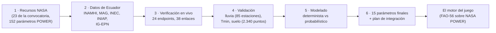

# 6 · La investigación detrás del juego

Toda la investigación está en [`Documentacion-Investigacion/`](../Documentacion-Investigacion/) (≈ 134 KB de texto, scripts reproducibles y 16 archivos JSON de resultados). Se hizo el **14 de noviembre de 2026** y **todos los endpoints se probaron en vivo**: las cifras salen de esas pruebas, no de la documentación. Este documento es el resumen para el pitch.

## 6.1 Qué se investigó

| Carpeta | Contenido | Resultado clave |
|---|---|---|
| `01-NASA/` | Los 23 recursos de la convocatoria, el catálogo completo de NASA POWER y la regla de fuentes | **12 de los 23 recursos cubren Ecuador**; los otros 11 son solo de EE. UU. (SSURGO, CDL, PRISM, NAIP, NASS…) y cada uno tiene equivalente ecuatoriano. POWER ofrece **152 parámetros diarios desde 1981** sin clave |
| `02-Ecuador/` | INAMHI, MAG (geoportal y SIPA), INEC ESPAC, INIAP, estudios de suelos | INAMHI: lluvia mensual de **947 estaciones (1960–2019)**. MAG: mapa geopedológico 1:25.000 con **202.145 polígonos**, zonificación por cultivo, riesgos de helada y sequía, precios 2016–2026 |
| `03-Verificacion-Endpoints/` | Volumen de datos, validación de lluvia, de temperatura mínima y de suelo, estado de endpoints | **24 de 24 endpoints** devuelven el dato esperado; 38 enlaces verificados |
| `04-Recomendaciones/` | Top 5, plan de integración, matriz NASA vs Ecuador, **los 15 parámetros finales** | Ver 6.3 |
| `05-Modelado/` | ¿Modelo determinista o probabilístico? | Lo viable es un **híbrido** (ver 6.4) |
| `06-Gases-y-Crecimiento/` | CO₂, SO₂, O₃, NO₂, aerosoles, luz, lancha, GPP/LAI, nutrientes | Lo que cambia la decisión en la sierra es el **SO₂ y la ceniza volcánica**; el CO₂ casi no varía |
| `07-Plan-de-Mejoras/` | Rúbrica de Space Apps Sangolquí y migración del chat a app móvil | Decisión: **PWA** (ver 6.6) |

## 6.2 Lo que encontramos al validar NASA contra el INAMHI

**Lluvia, 85 estaciones a 2.000 m o más (13 a 19 años cada una):**

| Fuente | Sesgo mediano | r mensual | Error mensual (MAE) | Mejor en |
|---|---:|---:|---:|---:|
| MERRA-2 (`PRECTOTCORR`) | +21 % | 0,51 | 51,5 mm | 33 estaciones |
| **IMERG** (`IMERG_PRECTOT`) | +39 % | **0,68** | **46,4 mm** | **50 estaciones** |
| ERA5 | +140 % | 0,66 | 110,5 mm | 2 estaciones |

- En la sierra centro, la celda gruesa de MERRA-2 **duplica la lluvia**: San Juan (Chimborazo) mide **658 mm/año** y MERRA-2 dice 1.415 mm.
- **IMERG sigue mejor los meses**, pero ninguna fuente acierta el volumen sin ajuste local.
- Calibrar con el INAMHI (validación cruzada dejando una estación fuera) baja el error anual de lluvia de **≈ 40 % a ≈ 15 %**.

**Temperatura mínima y heladas (24 estaciones, INAMHI 2013):** POWER sin corregir tiene sesgo de +0,15 °C; la corrección por altura de 6,5 °C/km **empeora la mínima en los valles** (Patate: +5,6 °C) porque no ve la inversión térmica nocturna. Ningún modelo detectó las 2 heladas observadas. *Por eso el juego no promete heladas: se muestran como frío (¡Achachay!) y no como pronóstico.*

**Suelo (FAO GAEZ v4 frente al MAG, 2.340 puntos de la sierra centro):**
- GAEZ ordena bien los terrenos (correlación 0,34 a 0,62), pero ve **la mitad de la pendiente** (mediana 23 % frente a 55 %).
- Marca 84 % de los puntos "sin restricción para raíces", cuando el MAG dice que **un tercio** son suelos superficiales o poco profundos.
- Su aptitud por cultivo da **cebada = 0** en Guamote, donde es un cultivo tradicional.
- **Conclusión:** el MAG debe ser la fuente principal de suelo y GAEZ el respaldo.

## 6.3 Los 15 parámetros finales

| Grupo | Parámetros | Fuente global | Contraste en Ecuador |
|---|---|---|---|
| **Clima y agua** | 1 Lluvia diaria · 2 Humedad en zona de raíces · 3 Temperatura nocturna de superficie | IMERG (POWER), `GWETROOT`/SMAP, MODIS LST | INAMHI (85 estaciones), MAG |
| **Terreno y vegetación** | 4 Pendiente · 5 Verdor NDVI/EVI | NASADEM 30 m, MODIS | MAG, INEC ESPAC |
| **Crecimiento y sanidad** | 6 Riesgo de lancha · 7 Productividad (GPP, LAI) · 8 SO₂ y ceniza · 9 Temperatura y humedad superficial del suelo · 10 Luz PAR y nubes | POWER horario, MODIS, OMI/OMPS | INAMHI, INIAP, IG-EPN |
| **Suelo** | 11 Profundidad y pedregosidad · 12 Textura y agua disponible · 13 pH y toxicidad · 14 Fertilidad · 15 Aptitud por cultivo | GAEZ (respaldo) | **MAG (principal)** y ZAE |

Datos que llaman la atención: el riesgo de **lancha** pasa de 27–29 días favorables en época lluviosa a 8–10 en agosto-septiembre; las nubes quitan **45 % de la luz**; la productividad (GPP/LAI) varía hasta **3 veces** entre puntos cercanos; unas **12.000 ha** se afectaron por ceniza en enero de 2024; **ningún satélite mide nutrientes del suelo**.

## 6.4 ¿Determinista o probabilístico?
El motor ya es **mitad y mitad**: la física es determinista (ET0 Penman-Monteith, Kc, USDA-SCS) pero corre el balance en **cada uno de los ~23 años** y resume con percentiles (mediana = año normal, percentil 80 = año seco). Un modelo de aprendizaje automático puro **no es viable**: no hay rendimientos por parcela para entrenarlo. Hallazgos de la prueba de sensibilidad: el error restante de los datos cambia el cultivo n.º 1 en el **14 %** de los casos, y en Guamote (octubre) la respuesta de avena gana solo **2 de cada 10 años**. *Por eso el juego muestra "en cuántos años de 23 alcanza la lluvia" en lugar de una sola respuesta.*

## 6.5 Qué parte de la investigación ya está en el juego y qué es hoja de ruta

| Hallazgo | En el juego hoy | Hoja de ruta |
|---|---|---|
| Lluvia, temperatura, sol, humedad y viento de NASA POWER | ✅ clima diario 2001–2024 | Cambiar a IMERG y calibrar con INAMHI |
| Humedad de suelo en raíces (`GWETROOT`) | ✅ ficha "Así es tu tierra" | SMAP `SPL4SMGP` |
| Corrección por la celda gruesa | ✅ ECMWF IFS 9 km mes a mes (respaldo 6,5 °C/km) | Factor INAMHI sobre IMERG |
| Balance de suelo con probabilidad de éxito | ✅ ~23 años por cultivo | Incertidumbre explícita por error de datos |
| Época de siembra INIAP y casos de rotación reales | ✅ calendario y 5 casos | Sumar ZAE del MAG |
| Pendiente | ✅ relieve Copernicus DEM (Open-Meteo), **no NASA** | NASADEM 30 m |
| Suelo | ✅ textura SoilGrids (agua útil) | **MAG como fuente principal**, GAEZ de respaldo |
| Riesgo de lancha, GPP/LAI, SO₂ y ceniza, PAR | ❌ documentado | Alertas y ciclos cortos |
| Heladas | ➖ medidas, no prometidas | Tmin de superficie MODIS |

**Transparencia que conviene decir en voz alta:** la regla del equipo es "todo NASA + recursos de la convocatoria". Hoy el juego aún usa tres fuentes que **no** son NASA (SoilGrids, Open-Meteo/Copernicus DEM y ECMWF IFS) porque funcionan sin clave y resuelven la celda gruesa; el juego las rotula así y `Documentacion-Investigacion/01-NASA/03-fuentes-permitidas.md` define su reemplazo (NASADEM, GAEZ + MAG, factor INAMHI). Además, la validación mostró que la corrección con IFS no mejoró en 7 estaciones (2018–2019), así que la lluvia del juego es útil para **comparar meses y años**, no para predecir milímetros exactos.

## 6.6 Plan de mejoras y rúbrica (Space Apps Sangolquí 2026)
La rúbrica pesa cuatro áreas: **RCD** (rigor científico y datos), **IET** (innovación y ejecución técnica), **IR** (impacto y relevancia) y **STP** (storytelling y presentación), con +3 por cada voto de nominación y hasta −8 por penalizaciones. Categorías donde encajamos: **Local Impact** (IR 50 %), **Best Use of Data** y **Best Use of Science** (RCD 50 %), Galactic Impact.

| Penalización (−) | Cómo se resolvió |
|---|---|
| P1 Repo público con licencia (−2) | Licencia **MIT** en la raíz; repositorio público; gitleaks en CI y hook local |
| P2 Datos NASA citados (−2) | Tabla de datos en el README, fuentes por enlace en la ficha y créditos de NASA POWER |
| P3 Enlaces públicos (−1) | Demo en https://pacha-chat.vercel.app |
| P4 Máximo 7 diapositivas (−1) | Presentación de 7 diapositivas ES y EN |
| P5 Declaración de IA y marca (−1) | Declaración en README y ficha; imágenes de IA con marca "IA"; sin logos NASA |
| P6 Bilingüe ES/EN (−1) | `README.en.md`, presentación y ficha en inglés, **botón ES/EN dentro del juego** |

Decisión técnica: **PWA** sobre el mismo motor (se instala desde el navegador, se muestra con un enlace público) en lugar de React Native o Flutter, que obligaban a reescribir el motor. El chatbot original pasó de ser el producto a un canal secundario.

## 6.7 Dónde mirar cada resultado

| Quiero ver… | Archivo |
|---|---|
| Lluvia: 85 estaciones | `03-Verificacion-Endpoints/02-validacion-lluvia-INAMHI.md` y `resultados/validacion_lluvia_85_estaciones.json` |
| Calibración (validación cruzada) | `resultados/calibracion_loo_lluvia.json` |
| Heladas | `03-validacion-temperatura-minima.md` |
| Suelo GAEZ vs MAG | `04-validacion-suelo-GAEZ-vs-MAG.md` |
| Estado de los 24 endpoints | `05-estado-de-endpoints.md` |
| Lancha, GPP/LAI, gases | `06-Gases-y-Crecimiento/` y `resultados/lancha_power_horario_guamote.json` |
| Sensibilidad de la recomendación | `resultados/sensibilidad_recomendacion.json` |
