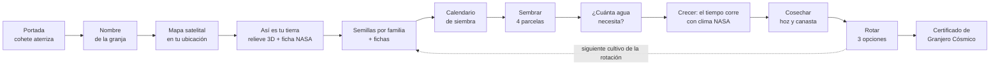

# 7 · Todo lo que hace el juego y cómo se construyó

## 7.1 Recorrido completo del juego

| # | Pantalla | Qué hace | Dato real |
|---|---|---|---|
| 1 | **Portada** | Paisaje por capas con movimiento (nubes, cóndor, aves, hierba, humo); cohete con llama y estela que aterriza con sonido y polvo | — |
| 2 | **Nombre de la granja** | Pachita lo pide desde su cohete | — |
| 3 | **Mapa** | Mapa satelital con nombres de pueblos y vías, abierto en tu ubicación. Círculo de 0,1 a 10 ha con deslizador (se puede escribir hasta 100 ha). Sin sitios de ejemplo | Punto real |
| 4 | **Así es tu tierra** | Parcela en 3D con su relieve y ficha técnica: lluvia de año normal y seco, evaporación, temperatura, días de calor, sol, humedad del aire y viento, humedad del suelo mes a mes, cambio de la última década y pendiente | NASA POWER + Copernicus DEM (rotulado) |
| 5 | **Semillas** | 13 cultivos como íconos animados, agrupados en 6 familias, con ficha (ciclo, altura, uso, meses). Candado con razón si no sirve por altura o época; 4 fichas de solo información que Pachita explica | `/api/app/semillas` |
| 6 | **Calendario** | Rueda de 12 meses con la época de siembra de la zona; si siembras fuera de época, Pachita avisa | INIAP |
| 7 | **Sembrar** | Tocar parcelas o "Sembrar todo" (2 × 2 parcelas). Al llenarlas, el tiempo corre solo | — |
| 8 | **¿Cuánta agua necesita?** | Litros que bebe el cultivo, lluvia, riego en año normal y seco; semáforo mes a mes | `/api/app/ciclo` |
| 9 | **Crecer** | Cronología con etapas y días para cosechar; sequía y calor (¡Arrarray!), frío y aguacero (¡Achachay!); tanque de agua, botón Regar, play/pausa | Clima diario real de un año |
| 10 | **Cosechar** | "Cosechar todo" con hoz animada y canasta que cuenta; **una tarjeta por semilla** con puntaje y estrellas | Puntaje calculado en el servidor |
| 11 | **Rotar** | Pachita explica por qué rotar y recomienda 3 rotaciones calculadas; la app **sigue la rotación elegida paso a paso** (p. ej. arveja → papa → mixtura) en la barra de arriba | `/api/app/cultivo` |
| 12 | **Certificado de Granjero Cósmico** | Pantalla completa (apaisado en escritorio, vertical en celular) con granja, cosechas, puntaje, rotación y medallas; se descarga como imagen | — |

## 7.2 Pachita, la guía
- Granjera de la sierra (sombrero, poncho y anaco), tres poses, globo de texto corto con **voz de niña** (`edge-tts`, es-EC o `en-US-AnaNeural`).
- Escribe con puntos mientras llega la voz y las palabras aparecen al ritmo del audio.
- **Controla el tiempo:** si pide regar o cosechar, el tiempo espera y el botón late hasta que el jugador actúa; si solo cuenta algo, el juego sigue. Los avisos repetidos usan frases fijas con la voz precargada al sembrar.
- Explica sin números técnicos: baldes, tanques, tanqueros.

## 7.3 Funciones transversales
| Función | Detalle |
|---|---|
| **Español / English** | Botón ES/EN en menú, mapa y barra; textos, nombres de cultivos y meses, certificado y **voz** cambian de idioma |
| **Mundo 3D y modo 2D** | three.js con relieve real y cielo día/noche; versión 2D igual de completa (`?sin3d=1`, o automática si el equipo no dibuja en 3D) |
| **Pantalla de carga** | Con consejos cuando algo tarda; el relieve, el clima, las semillas y el motor 3D se piden en paralelo |
| **Sonido** | Cohete, aterrizaje, cosecha y campanitas sintetizados con Web Audio (sin archivos) |
| **Modo económico** | Quita adornos animados en equipos modestos y respeta `prefers-reduced-motion` |
| **PWA** | Se instala en el celular y funciona a pantalla completa |
| **Sin cuenta, compras ni anuncios** | El servidor no guarda datos del jugador; la partida vive en el navegador |
| **Sin red en demos** | 4 sitios de demostración con datos guardados |

## 7.4 El segundo canal: bot de Telegram (@Pacha_EC_Bot)
El mismo motor atiende a las familias adultas en Telegram: el agricultor manda **un punto y un círculo** y recibe dibujos, mensajes cortos y audio: **Ver mi tierra**, **Qué sembrar** (con veredicto ✅ ⚠️ ❌), **Qué sembrar después** (rotaciones y 5 casos probados en Ecuador) y **Cuánto regar** (días de la semana y litros en baldes, tanques o tanqueros). Incluye modo kichwa (palabras por validar con hablantes nativos), notas de voz, y explicación con Gemini. El sitio web publicado es solo el juego; el bot sigue en el repositorio (`app/bot.py`).

## 7.5 Cómo se construyó (línea de tiempo, 14–15 de noviembre de 2026)

| Fase | Qué se hizo | PR |
|---|---|---|
| 1 · Bot | Menú para agricultores, motor de agua y rotaciones, modo campo con audio y kichwa, calendario y casos del Excel del equipo, voz ecuatoriana, notas de voz | primeros #9–#20 |
| 2 · Motor | Balance diario de suelo del equipo sobre NASA, veredicto y semáforo | #14 |
| 3 · Investigación | 24 endpoints, validación con INAMHI y MAG, 15 parámetros | #22 |
| 4 · Rúbrica | Licencia MIT, README bilingüe, plan de mejoras | #23 |
| 5 · App web | App web y móvil con Astro según el mock | #25 |
| 6 · Astro Granja | Juego con Pachita, historia, certificado, estilo 3D casual andino, voz de niña, ficha solo NASA, cohete, día/noche, parcelas 2 × 2, solo el juego en el sitio | #29–#36 |
| 7 · Mejoras de juego | Aterrizaje con sonido, mapa en tu ubicación, cronología, rotación continua, "Cosechar todo", certificado a pantalla completa | #37 |
| 8 · Bilingüe | Botón ES/EN con voz de Pachita en inglés | #38 |
| 9 · Pulido | Paisaje por capas, HUD, Pachita y el tiempo, cosecha animada, pantalla de carga | #39 |
| 10 · Entregables | Presentaciones ES/EN, ficha, capturas, licencia reconocible, escena 2D, hoz, avisos con voz precargada | #40–#44 |

En total, **33 commits** en `develop` en dos días, todos por Pull Request.

## 7.6 Calidad, seguridad y operación
- **CI en cada PR:** pruebas sin red, construcción de imagen Docker, `gitleaks` (secretos), despliegue de vista previa en Vercel y fusión automática cuando todo pasa.
- **Hook local** `.githooks/pre-commit` que bloquea secretos; ninguna clave en el código.
- **20 pruebas automáticas**: ET0 FAO-56 contra el ejemplo oficial, lluvia útil USDA-SCS, curvas Kc, clima de la sierra, banco y rotaciones, veredicto del balance, relieve sin red y fuera de Ecuador, validación de la API, voz con idioma y GET cacheable, nombres locales de suelo.
- **Recorridos con Playwright** del juego completo en escritorio, laptop y celular, en español y en inglés.
- **Despliegue:** FastAPI como función serverless de Vercel (hasta 60 s y 1 GB); sitio estático. Costo de operación casi cero.

## 7.7 Entregables ya hechos
| Entregable | Dónde |
|---|---|
| Presentación de 7 diapositivas ES y EN | `docs/entregables/Presentacion_ES.pdf`, `Presentation_EN.pdf` |
| Ficha del proyecto ES/EN (fuentes NASA, repo, licencia, declaración de IA) | `docs/entregables/Ficha_Proyecto_ES_EN.pdf` (fuente LaTeX en `ficha/`) |
| Capturas reales (menú, ficha, rotación, certificado, portada) en ES y EN | `docs/entregables/capturas/` |
| Diapositiva 1 en HTML y PDF vectorial | `docs/entregables/diapositiva-1-*.html` |
| README bilingüe y licencia MIT | raíz |
| Investigación completa | `Documentacion-Investigacion/` |
| Material de pitch (esta carpeta) | `APP-PITCH/` |

## 7.8 Equipo y herramientas
Equipo (según la presentación): **Nikol Montiel** (investigación), **Mathew Gutiérrez** (IA y datos), **Santiago Rubio** (diseño) y **Miguel Ávilez** (desarrollo). El código, la documentación y el análisis contaron con asistencia de **Claude Code (Anthropic)**; las ilustraciones de Pachita y de los cultivos se generaron con IA y llevan la marca "IA".
